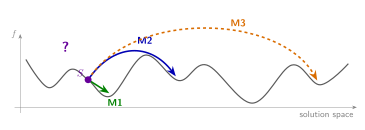
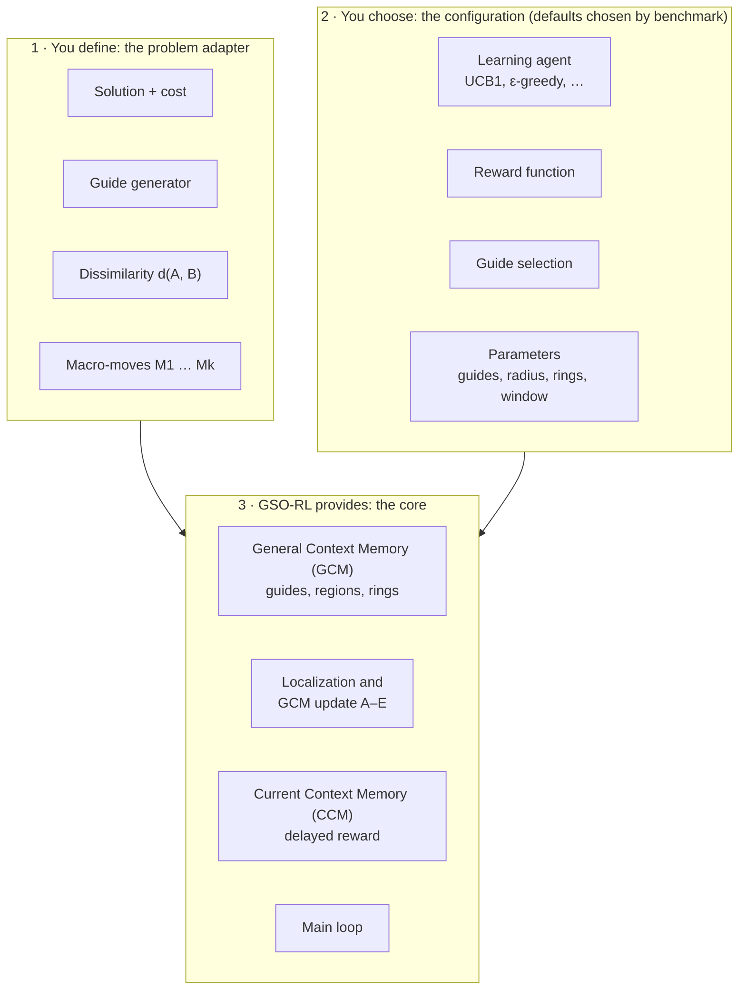
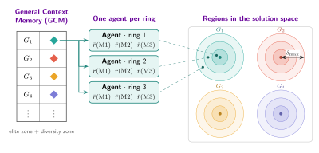
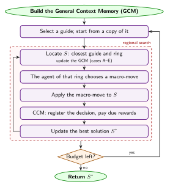

# GSO-RL — Guided Strategic Oscillation with Reinforcement Learning

[](https://doi.org/10.5281/zenodo.24508704)
[](https://github.com/JuanAdaySiverioGlez/gso-rl/actions/workflows/ci.yml)
[](LICENSE)

> **Status: v0.1.0.** The core library works and is tested, with a blank template and a complete
> example (0/1 knapsack). See [ROADMAP.md](ROADMAP.md).

GSO-RL is a metaheuristic framework for combinatorial optimization built around one question:

> *Can we learn, from a point S of the solution space, how best to decide where to move next?*

<p align="center">
  
</p>

It splits that question in two:

1. **Where am I?** A memory of **guiding solutions** (guides) maps the search space. Each guide
   is a concrete solution that represents a region. A new solution is located by its closest guide
   and by the concentric **ring** of that guide it falls in.
2. **What do I do here?** Each ring has its own **learning agent**. It chooses which
   **macro-move** to apply next, and learns from the delayed consequences of its choices in that
   region.

Instead of fixed rules for switching between search behaviors (intensify for a while, then jump
elsewhere), the switching is learned, region by region. GSO-RL was introduced on the Shared
Customer Collaboration Vehicle Routing Problem
([Siverio-González et al., 2027](https://doi.org/10.1016/j.eswa.2026.134651)), where it obtained
the best value in 22 of 24 large-scale instances against GRASP×ILS and a multi-neighborhood tabu
search.

### A tool to test the idea on your problem

Whether learning *per region* pays off depends on the problem: it can only help where different
regions of the search space need different macro-moves. GSO-RL ships with the controls that answer
it on your own problem: each one is a single configuration change
([docs/06](docs/06-experimental-protocol.md)).

| Control | Configuration | Question |
|---|---|---|
| Random choices | `--agent.type=random` | does the learned choice of macro-move matter? |
| Each macro-move alone | `--agent.type=fixed(move=...)` | is it learning, or one good macro-move? |
| One agent | `--agent.scope=global` | do agents per region beat one agent for the whole search? |
| Shuffled agents | `--agent.scope=shuffled` | **does the region matter**, or only having several agents? |

---

## How GSO-RL is built

GSO-RL has three layers. Only the first one depends on your problem.



| Layer | What it contains | Where it is explained |
|---|---|---|
| **1. Problem adapter** (you write it) | Your solution type and cost · how to build a guide · how different two solutions are · the macro-moves the agents choose among | [docs/03](docs/03-adapting-to-your-problem.md) |
| **2. Configuration** (you choose it) | Which agent, which reward, how guides are selected, and the numeric parameters. The defaults were chosen on four problems; presets hold the article's configurations | [docs/04](docs/04-learning-agents.md), [docs/05](docs/05-configuration.md) |
| **3. Core** (provided, not modified) | General Context Memory (GCM), localization and update of the memory, Current Context Memory (CCM), main loop | [docs/02](docs/02-framework.md) |

A **macro-move** is any procedure that transforms the current solution: a complete search
procedure, one parametrization of a search engine, or a single neighborhood operator. GSO-RL does
not assume what your macro-moves do; the agents learn when each one pays off.

A **solution** can be of any type: a set (knapsack, location), a permutation or routes (TSP,
vehicle routing), or a vector of real numbers (continuous optimization, for example the best value
of a parameter at each of several sites). GSO-RL only needs its cost and a distance between two
solutions ([docs/03](docs/03-adapting-to-your-problem.md)).

## The memory: guides, regions, rings, agents

<p align="center">
  
</p>

Each guide `G_i` is a stored solution. Its region is every solution within distance `δmax`, split
into concentric rings, and each ring has its own agent with the mean reward `r̄` of every
macro-move.

## The main loop

<p align="center">
  
</p>

Every box is specified in [docs/02-framework.md](docs/02-framework.md); a step-by-step example is
in [docs/01-what-is-gso-rl.md](docs/01-what-is-gso-rl.md#one-iteration-step-by-step).

---

## Quick start

```bash
git clone https://github.com/JuanAdaySiverioGlez/gso-rl.git && cd gso-rl
cmake -S . -B build && cmake --build build
./build/knapsack                       # GSO-RL on a random 0/1 knapsack instance
./build/knapsack --check               # checks the adapter and suggests parameter values
./build/knapsack --help                # every parameter, with default and meaning
./build/knapsack --agent.type=random   # the same run with random choices (ablation)
cd build && ctest                      # tests of the core, the example and the template
```

To use GSO-RL on your problem, copy [templates/my_problem/](templates/my_problem/) and fill in the
`TODO`s ([docs/03](docs/03-adapting-to-your-problem.md)).

Requirements: a C++17 compiler and CMake 3.15+. The library itself is only headers: to use it in
your project, add `include/` to the include path (or `add_subdirectory` and link `gso::gso`) and
`#include <gso/gso.hpp>`.

## Repository structure

```
gso-rl/
│
├── README.md              you are here: what GSO-RL is and how the repository is organized
├── AGENTS.md              instructions for AI coding assistants (CLAUDE.md points to it)
├── llms.txt               index of the documentation for language models
├── ROADMAP.md             what is done, what comes next, design decisions
├── CHANGELOG.md           versions
├── CITATION.cff           how to cite (GitHub "Cite this repository" button)
├── LICENSE · NOTICE       Apache 2.0 for the code; NOTICE must travel with every copy
│
├── docs/                  everything needed to understand and use GSO-RL
│   ├── 01-what-is-gso-rl.md            idea, vocabulary, one iteration step by step
│   ├── 02-framework.md                 the specification: loop, GCM, update A–E, CCM, reward
│   ├── 03-adapting-to-your-problem.md  the adapter: what you write, API, checklist
│   ├── 04-learning-agents.md           agents available and how to add one
│   ├── 05-configuration.md             every parameter, defaults, presets of the article
│   ├── 06-experimental-protocol.md     does it pay off on your problem? controls, statistics
│   ├── 07-tuning.md                    tuning the parameters for your problem with irace
│   ├── figures/                        figures used by the documentation
│   ├── papers/                         articles that define GSO-RL (PDF + summary + BibTeX)
│   └── talks/                          presentations
│
├── CMakeLists.txt         builds the example and the tests
├── include/gso/           the C++17 header-only library: #include <gso/gso.hpp>
├── templates/my_problem/  a blank adapter with one TODO per part: copy it to start
├── examples/knapsack/     a complete adapter (0/1 knapsack): every part written
├── tools/irace/           irace kit: parameter space, target runner, scenario (docs/07)
├── tests/                 tests of the core
└── .github/workflows/     continuous integration: build and tests on Linux, macOS and Windows
```

**Rule of thumb:** `include/gso/` is the same for every problem; everything specific to a problem
lives in its own folder under `examples/` or in your project.

## Using an AI assistant

The repository is written so that an AI coding assistant can adapt GSO-RL to your problem. Claude
Code and Codex read [AGENTS.md](AGENTS.md) automatically; for a chat assistant, give it
[llms.txt](llms.txt) or the `docs/` folder. Then ask, for example:

> Adapt GSO-RL to my problem. My solutions are ..., the objective is ..., and these are the
> procedures I want as macro-moves: ... . Follow AGENTS.md.

## How to cite

If you use GSO-RL, its code or its documentation, please cite:

```bibtex
@article{SiverioGonzalez2027GSORL,
  author  = {Siverio-Gonz{\'a}lez, Juan Aday and Meli{\'a}n-Batista, Bel{\'e}n and Moreno-Vega, J. Marcos},
  title   = {Guided strategic oscillation with reinforcement learning for the shared customer
             collaboration vehicle routing problem},
  journal = {Expert Systems with Applications},
  volume  = {334},
  pages   = {134651},
  year    = {2027},
  doi     = {10.1016/j.eswa.2026.134651}
}
```

To cite the software itself (a specific version, for reproducibility), use its archive on Zenodo:
[doi:10.5281/zenodo.24508704](https://doi.org/10.5281/zenodo.24508704) (all versions; each
version has its own DOI on that page).

## License

- **Code:** [Apache License 2.0](LICENSE). Redistributions, including modified versions, must keep
  the [NOTICE](NOTICE) file, which credits GSO-RL, this repository and the article.
- **Documentation** (`docs/`, except the papers): [CC BY 4.0](docs/LICENSE). Reuse requires
  attribution.
- **Articles** in `docs/papers/` keep their own license, stated in each folder.
