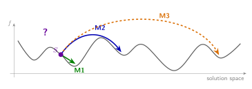
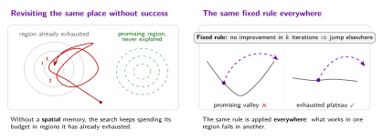
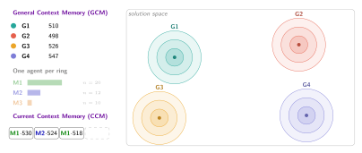
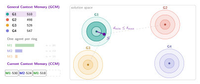
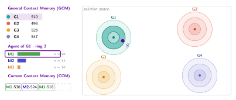
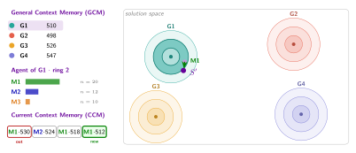
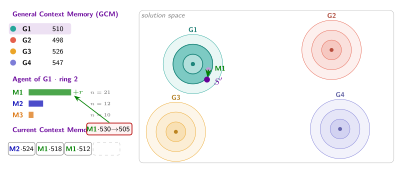
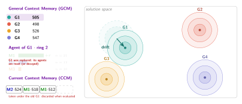
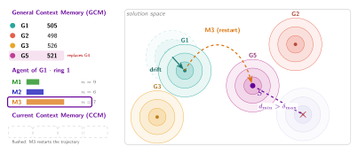

# 1. What is GSO-RL

## The question

> Can we **learn** how best to decide **where to move** from a point `S` of the solution space?

  

GSO-RL answers it in three parts:

| Question | How GSO-RL answers it |
|---|---|
| **Where am I?** | A memory of guiding solutions places `S` in a known region (or detects a new one) and in a ring of that region. |
| **What do I do here?** | The agent of that ring chooses a macro-move, learning from what has worked **in that region**. |
| **Does learning per region help here?** | It depends on the problem, and you can measure it: GSO-RL ships with the controls (random choices, each macro-move alone, one agent for the whole search, agents not tied to any region) and a script that runs them ([06](06-experimental-protocol.md)). |

## Two recurring problems it targets

  

1. **Passing through the same place without success.** Without a spatial memory, a search can keep
   spending its budget in regions it has already exhausted.
2. **Fixed decisions everywhere.** A rule such as "if there is no improvement in `k` iterations,
   jump elsewhere" is applied identically in a promising valley and on an exhausted plateau. What
   works in one region may fail in another.

GSO-RL combines a **memory organized by regions**, to know where the search is, with **agents that
learn in each region** which macro-move to apply. Its roots are tabu search (memory guides the
search), strategic oscillation (alternating search behaviors) and multi-armed bandits (learning
which action pays off). The idea is to *think before acting*: spend a little computation locating
the search so that the expensive computation goes where it is useful.

Learning per region can only pay off where regions differ in what they need. On a problem where
the same macro-move is best everywhere, one agent learns as much as many. That is why each part of
the method has a control that removes it ([06](06-experimental-protocol.md)): use them to find out
what your problem needs.

## Vocabulary

| Term | Meaning |
|---|---|
| **Guide** | A concrete solution stored in the memory that represents a region. Regions have no other definition: a region is "everything close enough to this solution". |
| **Region** | All solutions within dissimilarity `δmax` of a guide. |
| **Ring** | One of `n_rings` concentric bands of a region, from its center to its edge. Each ring has its own agent, so a region can learn different behavior near its center and near its edge. |
| **Macro-move** | Any procedure that transforms the current solution: a complete search procedure, one parametrization of a search engine, or a single neighborhood operator. The set of macro-moves is the action set of the agents. |
| **Agent** | A learner (UCB1 in the article) that chooses the macro-move for one ring. |
| **GCM** (General Context Memory) | The table of guides, split into an elite zone (admitted for quality) and a diversity zone (admitted for novelty, with an expiry). |
| **CCM** (Current Context Memory) | A window with the latest decisions, waiting to be rewarded once their effects are visible. |
| **Delayed reward** | A decision is scored `SZ_ccm` steps later, or earlier if the trajectory is restarted. |
| **Contextual validation** | A delayed reward is discarded if the guide where the decision was taken has been replaced. |

## One iteration, step by step

A small example with 4 guides, 3 rings per guide, 3 macro-moves `M1, M2, M3`, and a CCM of size 3.

**Step 1 · The memory.** The GCM holds four guides with costs `G1 = 510`, `G2 = 498`, `G3 = 526`,
`G4 = 547`. Each guide defines a region with 3 rings and one agent per ring. The CCM holds the last
three decisions with the cost at the time they were taken: `M1·530`, `M2·524`, `M1·518`.

**Step 2 · Locate.** The guide closest to the current solution `S` is `G1`, and
`d(S, G1) ≤ δmax`: `S` is in the region of `G1`, ring 2.

**Step 3 · Decide.** The agent of `G1`·ring 2 combines what it has learned with an exploration
bonus (UCB1) and chooses `M1`.

**Step 4 · Apply and register.** `M1` is applied: `f(S') = 505 < f(S) = 512`. The decision
`M1·512` enters the CCM, still without a reward.

**Step 5 · Delayed reward.** The CCM is full, so its oldest decision (`M1·530`) leaves and is
evaluated with what happened afterwards: `530 → 505`. The reward is positive and the value of `M1`
rises in the ring where that decision was taken.

**Step 6 · Update the GCM.** `S'` improves `G1` (`505 < 510`), so it becomes the new guide
(case A): the region drifts toward the bottom of its valley. With the article's configuration, the
agents of `G1` restart, and pending decisions taken under the old `G1` will be discarded when they
are evaluated (contextual validation).

**Step 7 · A new region.** Later, an agent chooses `M3`, a macro-move marked `restart`: `S` jumps
far away and `d_min > δmax`. Because `f(S) = 521` improves the worst guide (`547`), `S` replaces
`G4` (case C). Since `M3` restarts the trajectory, the CCM is flushed: all pending decisions are
evaluated now.

## How it differs from related approaches

- **Hyper-heuristics** also select among high-level procedures, usually with one global selector
  and a single history for the whole search. In GSO-RL the history is conditioned on the
  **position in the search space**: one independent agent per ring of each region.
- **Scatter search / path relinking** keep a reference set of solutions to combine them. GSO-RL's
  guides are **landmarks**: they tell the search where it is and which agent to consult.
- **Classical strategic oscillation** crosses boundaries (often feasible/infeasible) according to
  predefined schedules. In GSO-RL the transitions between macro-moves are decided online, from
  accumulated regional performance.

## Where to go next

- The exact framework: [02-framework.md](02-framework.md)
- Applying it to your problem: [03-adapting-to-your-problem.md](03-adapting-to-your-problem.md)
