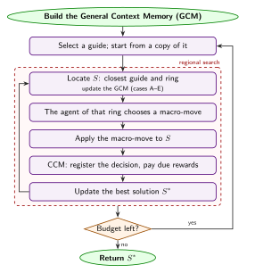
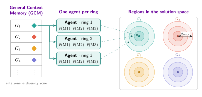
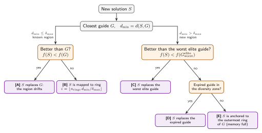
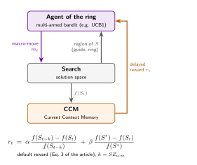

# 2. The GSO-RL framework (specification)

This document is the **reference specification** of GSO-RL. It describes the framework in general
terms: what is fixed, what is configurable, and what the user provides. The configuration used in
the article ([Siverio-González et al., 2027](papers/2027-eswa-scc-vrp/)) is one instance of it,
available as a preset ([05-configuration.md](05-configuration.md)).

Any implementation in this repository, and any port to another language, must follow this
document. A deliberate difference must be added to the [implementation notes](#implementation-notes).

Notation: `f(S)` is the cost of solution `S` (minimization); `d(S, G)` the dissimilarity between
two solutions; `S*` the best solution found so far; `M = {M1, …, Mk}` the set of macro-moves.

---

## 2.1 Components

Some components exist in two forms: the one described in the text of the article, and the one
of the implementation used for its experiments. Both are available; the user chooses when
instantiating ([05-configuration.md](05-configuration.md) gives the defaults).

| # | Component | Decides | Provided by | Article's text | Article's experiments |
|---|---|---|---|---|---|
| 1 | Solution + cost | what is optimized | **user** | | |
| 2 | Guide generator | how a guide is built | **user** | | |
| 3 | Dissimilarity `d` | which solutions are close | **user** | | |
| 4 | Macro-moves `M` | what the agents can do | **user** | | |
| 5 | Guide selection | which region a regional search starts from | `search.guide_selection` | `geometric(p=0.25)` over the cost ranking | `ucb(c=1.4)`: quality + exploration over visits |
| 5b | Schedule | one guide per iteration, or every guide in turn | `search.schedule` | one guide | one guide |
| 6 | Memory update rule | how a new solution changes the GCM | `gcm.update` | `cases` A–E, elite and diversity zones | `expiry_first`: expired guides replaced first, no zones |
| 7 | Rings and zones | granularity of the regions | `region.rings`, `gcm.elite_ratio` | 3 rings, 70 % elite | 1 ring |
| 8 | Whose agent decides | the agent consulted for each macro-move | `search.agent_of` | `closest`: the guide closest to `S` | `start`: the guide the regional search started from |
| 9 | Agent | which macro-move to apply | `agent.type` | UCB1 | UCB1 |
| 10 | Agent on guide replacement | what the agents of a replaced guide keep | `agent.on_replace` | `reset` | `decay(lambda=0.5)` |
| 10b | Case A | whether a guide improved inside its own region is a new guide | `gcm.case_a` | `renew` | `renew` (default: `drift`) |
| 11 | Reward | how a decision is scored | `reward.type` | Eq. 3 | 6/1/0: `levels(best=6, guide=0, current=1)` |
| 12 | CCM window | how long a decision waits for its reward | `ccm.size` | 30 | 2 |
| 13 | Radius and tenure | size of a region; lifetime of a guide | `region.delta_max` / `delta_ratio`, `gcm.tenure` | `γ`; 800 iterations | 0.3 (Jaccard); 0.15 × the time limit |
| — | Localization, CCM mechanics, contextual validation, main loop | | **core** (fixed) | | |

---

## 2.2 Main loop

```
procedure GSO-RL
 1:  CCM ← ∅
 2:  GCM ← build |G| guides with the guide generator
 3:  S*  ← best guide
 4:  repeat until the budget (iterations or time) is exhausted        ▷ global iteration
 5:      S ← copy of SelectGuide(GCM)                                  ▷ Phase 1: region selection
 6:      for j = 1 to regionSearchIter_max do                          ▷ Phase 2: regional search
 7:          (guide, ring) ← LocateAndUpdate(S, GCM)                   ▷ Section 2.4
             if search.agent_of = start: guide ← the guide of line 5   ▷ Section 2.5
 8:          m ← Agent(guide, ring).select()                           ▷ Section 2.5
 9:          S ← apply macro-move m to S
10:          UpdateCCM((guide, ring), m, f(S))                         ▷ Section 2.6
11:          if f(S) < f(S*) then S* ← S
12:      flush the CCM                                                 ▷ note N5
13:  return S*
```

`search.schedule = all` replaces line 5 by a loop over every guide, in slot order: each global
iteration becomes a round in which every guide runs its own regional search (lines 6–12), as if each
guide had its own loop. Each regional search counts as one iteration of the budget, and
`search.guide_selection` is not used. The default, `select`, is the procedure above.

<p align="center">
  
</p>

---

## 2.3 General Context Memory (GCM)

The GCM stores `|G|` **guides**. A guide is a concrete solution that represents a region:

- **Region** of guide `G`: every solution `S` with `d(S, G) ≤ δmax`.
- **Rings:** the region is split into `n_rings` concentric rings of equal width `δmax / n_rings`.
  With `n_rings = 1` there is one ring per guide.
- **Agents:** each ring has its own learning agent, so the GCM holds `|G| × n_rings` independent
  agents. Each one keeps the reward history of every macro-move in its ring.

<p align="center">
  
</p>

With `gcm.update = cases` the guides are split in two **zones** (with `expiry_first` there are no
zones):

| Zone | Share (`elite_ratio`) | Admission | Purpose |
|---|---|---|---|
| Elite | `elite_ratio · \|G\|` (article: 70 %) | quality | keep the best regions |
| Diversity | the rest (article: 30 %) | novelty | keep injecting new regions |

Guides have a **tenure** (`gcm.tenure`, in iterations, seconds, or as a fraction of the budget):
once it is exceeded the guide is *expired* and may be replaced. With `cases` only diversity guides
expire; with `expiry_first` any guide does.

**Initialization.** Call the guide generator `|G|` times and insert each result. `S*` is the best
guide.

---

## 2.4 Localization and GCM update

For the current solution `S`:

```
G_closest ← argmin over guides G_i of d(S, G_i)
d_min     ← d(S, G_closest)
```

Then the memory is updated with one of two rules (`gcm.update`); both use the same five cases.

**`cases`** (the article's text). Exactly one of five cases applies:

<p align="center">
  
</p>

| Case | Condition | Effect on the GCM | Region state returned |
|---|---|---|---|
| A | `d_min ≤ δmax` and `f(S) < f(G_closest)` | `S` replaces `G_closest` | `(G_closest, ring 0)` |
| B | `d_min ≤ δmax`, otherwise | none | `(G_closest, ⌊n_rings · d_min / δmax⌋)`, clamped to the last ring |
| C | `d_min > δmax` and `f(S) <` worst elite guide | `S` replaces the worst elite guide | `(new guide, ring 0)` |
| D | `d_min > δmax`, an expired diversity guide exists | `S` replaces it | `(new guide, ring 0)` |
| E | `d_min > δmax`, otherwise (memory saturated) | none | `(G_closest, last ring)` |

**`expiry_first`** (the implementation of the article's experiments). No zones; the first rule
that applies:

| Case | Condition | Effect on the GCM | Region state returned |
|---|---|---|---|
| D | some guide's tenure has expired (the first in slot order) | `S` replaces it, whatever `S` is | `(new guide, ring 0)` |
| A | `d_min ≤ δmax` and `f(S) < f(G_closest)` | `S` replaces `G_closest` | `(G_closest, ring 0)` |
| B | `d_min ≤ δmax`, otherwise | none | `(G_closest, ring of d_min)` |
| C | `d_min > δmax` and `f(S) <` the worst guide | `S` replaces the worst guide | `(new guide, ring 0)` |
| E | otherwise | none | `(G_closest, last ring)` |

**Agents of a replaced guide** (cases A, C, D) follow `agent.on_replace`: *reset* (they restart from
an empty state) or *decay(λ)* (they keep a fraction λ of their statistics).

**Case A** has two readings (`gcm.case_a`). *renew* (the article): the improved solution is a new
guide, with a new identity; its agents follow `agent.on_replace` and the decisions still waiting in
the CCM for that guide are discarded by the contextual validation (Section 2.6). *drift*: the region
is the same one, moved; the guide keeps its identity and its agents, so those pending decisions are
rewarded. Only cases C and D then create new guides. With *renew*, a decision that improves its
own guide is never rewarded unless it leaves the CCM before the next localization (`ccm.size = 0`
or the end of the regional search).

**Saturated regions** (`region.saturation`, `region.on_saturation`). A guide is *saturated* after
`region.saturation` regional searches in a row from it that did not improve it. The summary reports
how much of the search starts from saturated guides and which macro-moves are chosen there. With
`region.on_saturation = replace` the saturated region is abandoned: a new guide built by the guide
generator takes its slot (its agents follow `agent.on_replace`), so the search is forced to diversify
when a region is exhausted. The best solution found is kept in any case. Two controls measure what
knowing *which* region is exhausted adds (note N19): `replace_other` abandons, at the same moments,
another region chosen at random instead (the saturated one keeps its guide and its count starts
again), and `replace_random(p)` abandons a region chosen at random with probability p after each
regional search, whatever its state.

Two properties follow from these rules and must be preserved:

- **Dispersion:** a new region is created only when `d_min > δmax`, so guides are at least `δmax`
  apart when inserted.
- **Drift:** case A moves a region's center toward better solutions; regions slide to the bottom
  of their valleys while keeping their slot in the memory.

---

## 2.5 Choosing a macro-move

Whose agent decides is set by `search.agent_of`:

- `closest` (the article's text): the agent of the guide closest to `S` and of the ring `S` falls
  in, as returned by the update (Section 2.4).
- `start` (the article's experiments): the agent of the guide the regional search started from
  (line 5 of the main loop), in the ring of `S` with respect to that guide.

That agent (`agent.type`, see [04-learning-agents.md](04-learning-agents.md); the article uses UCB1)
selects one macro-move from `M`.

What the framework assumes about macro-moves:

- There are `k ≥ 2` of them, each with a name. They are opaque procedures: the framework does not
  know what they do.
- A macro-move may be marked **`restart`** when it produces a solution unrelated to the current
  one (in the article, CI builds a new solution from scratch). Before it is applied, the CCM is
  flushed (Section 2.6).
- A macro-move may pass through solutions better than `S*` before finishing elsewhere; it reports
  them to the framework, which updates `S*`.

---

## 2.6 Current Context Memory (CCM) and reward

<p align="center">
  
</p>

A decision is not rewarded when it is taken, but once its consequences are visible. Each decision
is stored with the state it was taken in: its guide (identity), ring, macro-move, `f(S)`, `f(S*)`
and the cost of its guide. The CCM is a FIFO queue that holds up to `SZ_ccm` pending decisions
(`ccm.size`). Pending decisions are rewarded:

1. **Window saturation:** when a decision arrives and the CCM already holds `SZ_ccm`, the oldest
   one leaves and is rewarded with the current state. A decision is therefore rewarded `SZ_ccm`
   macro-moves after its own. `SZ_ccm = 0` rewards every decision right after its own macro-move
   (immediate reward, the ablation GSO-WithoutCCM).
2. **Restart flush:** before a `restart` macro-move is applied, all pending decisions are rewarded
   with the current solution, the last one that descends from them, and the CCM is emptied. The
   restart decision itself then enters the empty CCM (note N9).
3. **End of the regional search:** all pending decisions are rewarded (note N5).

**Contextual validation** (always on). Before scoring a decision, check that the guide whose agent
took it is still the same guide (same identity). If it has expired or been replaced in the
meantime, the evaluation is **discarded**: the region it describes no longer exists, and scoring it
would credit an agent that did not take the decision.

**Reward** (component 8, `reward.type`). The reward function receives the cost, the best cost and
the guide's cost when the decision was taken, and the cost and best cost when it is evaluated.
Default — Eq. 3 of the article:

```
r = α · ( f(S_decision) − f(S_now) ) / |f(S_decision)|  +  β · ( f(S*_now) − f(S_now) ) / |f(S*_now)|
```

The first term measures the improvement that followed the decision; the second, how close the
trajectory is to the best solution found. Article: `α = 0.75`, `β = 1 − α = 0.25`. The absolute
values (note N7) make the formula valid for negative costs; for positive costs it is Eq. 3.

The reward updates the agent of the ring where the decision was taken.

---

## Implementation notes

Details that the article leaves open or that the framework generalizes. Each entry says what is
decided and why.

| # | Detail | Decision | Status |
|---|---|---|---|
| N1 | How the article derives `δmax` from the tuned factor `γ` (Table 2) | `δmax` is a percentage of a reference distance: the largest possible distance or the largest known distance. Available as `region.delta_ratio` with `region.delta_reference = adapter` (the adapter's `max_distance()`) or `guides` (the largest distance between the initial guides, fixed for the run). The exact value of `γ` for the presets is pending | partly open (author) |
| N2 | Unit of the tenure: Table 2 lists iterations (550 / 800); Section 5.5.4 reports 0.15 × the time limit, in seconds, for the large instances | `gcm.tenure_unit` = `iterations` (global iterations) or `seconds`; the presets use iterations, as Table 2 | decided; article value open (author) |
| N3 | Agent rewarded for a decision taken in case E | the agent of the outermost ring of `G_closest` | decided |
| N4 | Agents of a slot replaced in cases C and D | same policy as case A (`agent.on_replace`) | decided |
| N5 | Pending decisions when a regional search ends | rewarded with the current solution, because the next regional search starts from another guide and would score them against an unrelated solution | decided |
| N6 | Scale of `d` | free: `δmax` is expressed in the units of `d`. The article's SCC-VRP measure is a count, not a fraction. Normalizing `d` to `[0, 1]` is recommended because `δmax` then transfers between instance sizes | decided |
| N7 | Eq. 3 with negative costs (maximization written as minimization) | denominators in absolute value; identical to Eq. 3 for positive costs | decided |
| N8 | Bandits with delayed rewards | agents count a pull when they choose a macro-move and update the mean when its reward arrives; otherwise UCB1 would repeat the same choice while its rewards are on the way | decided |
| N9 | When the restart flush happens | before the restart macro-move is applied: the pending decisions are judged on the trajectory they belong to | decided |
| N10 | Zones at initialization; the elite guide removed in case C | the best `round(elite_ratio · \|G\|)` initial guides are elite; in case C the new solution takes the slot and the old elite guide leaves the memory | decided |
| N11 | Tenure | only diversity guides expire; the clock of a slot restarts whenever it receives a new solution; in case D the guide that expired first is replaced | decided |
| N12 | Budget | checked after every macro-move and before every regional search; a macro-move is never interrupted (it can consult `ctx.out_of_budget()`) | decided |
| N13 | Order in which a bandit tries its untried macro-moves | at random: agents are reset whenever their guide is replaced, and a fixed order would favour the first macro-move | decided |
| N14 | Two forms of guide selection, memory update and decision agent | both available (`search.guide_selection`, `gcm.update`, `search.agent_of`): the article's text and the implementation of its experiments | decided |
| N15 | Rewards of decisions whose guide was replaced | always discarded; the implementation of the experiments credited them to the new guide's agent, which did not take the decision | decided |
| N16 | Is a guide improved in its own region (case A) a new guide? | `gcm.case_a`: `renew` (yes, the article; used by its presets) or `drift` (no: same identity and agents; the default, so that a region's agent keeps its experience and its successful decisions are rewarded) | decided by benchmark ([05](05-configuration.md)) |
| N17 | Controls for regional learning | `agent.scope = global`: one agent for the whole search instead of one per ring of each guide. `agent.scope = shuffled`: as many agents as with `region` (`gcm.size × region.rings`), each decision taken by one of them drawn at random, which receives its reward; these agents are not reset when a guide is replaced. Not part of the method: baselines to measure what learning per region adds, over one learner (`global`) and over several learners unrelated to the regions (`shuffled`) | decided |
| N18 | Value of a region | `search.guide_selection = value(a, b)`: each guide keeps the discounted count of the regional searches from it that improved it or the best solution and of those that did not (`search.value_discount`); Thompson sampling over them chooses where to search. Kept when the guide drifts (case A, `drift`), reset when the slot gets a new guide. Not in the article: what a region is worth changes as it is exploited, which an average of all its history (the agents of the rings) does not follow | extension |
| N19 | Controls for abandoning saturated regions | `region.on_saturation = replace_other` (the same number of regions abandoned at the same moments, but not the saturated one) and `replace_random(p)` (a region at random with probability p after each regional search); not part of the method, baselines to measure what the memory of each region adds to `replace` | extension |
